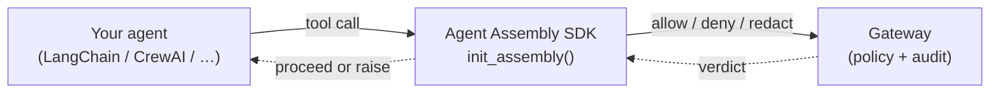

# Agent Assembly Python SDK

**In plain terms:** this SDK is how a Python agent asks for permission before it acts.
You wrap your existing agent in one `init_assembly()` call, and each
tool call that reaches an installed adapter hook is checked against a governance policy — allowed or denied —
without you rewriting a single line of the agent itself. Over a connected runtime the
outcome of each call is also handed to the runtime's event channel (see below).

It is two things in one package:

- a **pure-Python client** that talks to the Agent Assembly **gateway** (the policy brain),
  and
- an **in-process governance shim** that quietly hooks into the agent framework you already
  use (LangChain, CrewAI, LangGraph, …) and routes its tool calls through that gateway.

You keep writing agents the way you always have. The SDK is the seatbelt you click in once.

> **New to Agent Assembly?** This SDK is one of three interception layers in the broader
> platform. For the product overview, the gateway, and the policy model, see the core
> [Agent Assembly documentation](https://docs.agent-assembly.com/core/) and the
> [documentation hub](https://docs.agent-assembly.com/).

## What it wraps

The SDK does not replace your agent framework — it **intercepts** it. When you call
`init_assembly()`, the SDK detects which supported framework is importable in your process
and installs its adapter. **For LangChain,** `init_assembly()` only creates the callback handler,
and LangChain runs a tool ungoverned unless you pass it as `callbacks=[...]` (see the README
Quick Start). For other frameworks, see [Framework support](examples/framework-support.md) and that framework's example page for what it requires. Today it ships adapters for **LangChain, LangGraph, CrewAI, OpenAI Agents,
Pydantic AI, Google ADK, and MCP servers**.

## Who it's for

- **Developers** who want to add governance to an existing Python agent without re-architecting it.
- **Platform teams** standing up a policy gateway who need their agents to report to it.
- **Operators** who need agents to run under a policy gate they control, with identity and
  lineage registered against the gateway.

Note that an **audit trail of governed tool calls depends on a reachable runtime** —
see the note under "Why use it" below.

## Why use it

- **Framework adapters** for LangChain, LangGraph, CrewAI, OpenAI Agents, Pydantic AI,
  Google ADK, and MCP servers — drop in, no agent rewrites required.
- **Pre-execution policy enforcement** — block disallowed tool calls *before* they run.
- **Agent lineage** — parent / root / team identity is registered with the gateway and
  carried on every policy check.

!!! note "Audit evidence depends on a reachable runtime"

    The framework adapters offer the outcome of every governed call to an audit hook
    on the governance interceptor. Over a connected runtime that hook resolves and
    writes the record to the native event channel — the same channel agent
    registration uses. That covers the eleven governing adapters on the **allowed**
    path and, since AAASM-5787, on the denied one as well (see below).

    Without a reachable runtime there is no channel to send on, the hook does not
    resolve, and nothing is emitted; no claim of attributability or after-the-fact
    review holds on that path. Enforcement is unaffected either way: a policy DENY
    still blocks the tool, and the proxy / eBPF layers remain authoritative.
    `init_assembly()` warns when no record can be sent and reports `audit_sink` on the
    returned context. Delivery is best-effort: a failed send degrades to no record
    rather than to a failed tool call
    ([AAASM-5750](https://lightning-dust-mite.atlassian.net/browse/AAASM-5750)).

    **A handoff is not evidence.** The send
    is unacknowledged, so this SDK cannot report that a record arrived and does not
    claim it did — and downstream,
    [AAASM-5783](https://lightning-dust-mite.atlassian.net/browse/AAASM-5783) is open
    on `report_event` payloads reaching neither the live stream nor the durable
    entry, so no SDK can claim ADR 0033 §6 *Observed* until it lands. That limit
    applies to the denied path as much as the allowed one: the eleven governing
    adapters build a record on both
    ([AAASM-5787](https://lightning-dust-mite.atlassian.net/browse/AAASM-5787)),
    and the record carries a denial marker so a blocked call is distinguishable
    from a tool that ran and returned the denial text — but handing it over is
    still a handoff, not evidence.
- **Native PyO3 fast path** (optional) — drop into a Rust runtime client when you need
  sub-millisecond policy checks.
- **Typed throughout** — typed models for every gateway payload; the package ships a
  `py.typed` marker so your own type checker understands the API.

## Where to go next

| If you want to… | Go to |
| --- | --- |
| Install and govern your first agent in 5 minutes | **[Quick Start](quick-start.md)** |
| Understand the adapter pattern, modes, and lifecycle | **[Core Concepts](concepts/index.md)** |
| See real framework integrations and decision handling | **[Examples](examples/index.md)** and **[Guides](guides/index.md)** |
| Configure the gateway URL, API key, and modes | **[Configuration](configuration.md)** |
| Look up a class, exception, or model | **[API Reference](api-reference/index.md)** |
| Check Python / core-runtime compatibility and releases | **[Compatibility & Versioning](compatibility/index.md)** |
| Diagnose an error | **[Troubleshooting](troubleshooting.md)** |

## Project status

**Pre-1.0 (`0.x`) — published and usable, API not yet frozen.** The SDK is released to PyPI
from the `0.0.x` line. Until `1.0.0`, minor versions may introduce breaking changes to the
public surface; pin an exact version (`agent-assembly==0.0.x`) if you need a stable contract.
See [Compatibility & Versioning](compatibility/index.md) for the full policy.

## Versions

This site is published with [`mike`](https://github.com/jimporter/mike) — use the version
selector at the top of the page to switch between **stable** (the latest released version)
and **latest** (the head of `master`). Older versions remain accessible at their pinned URLs.
